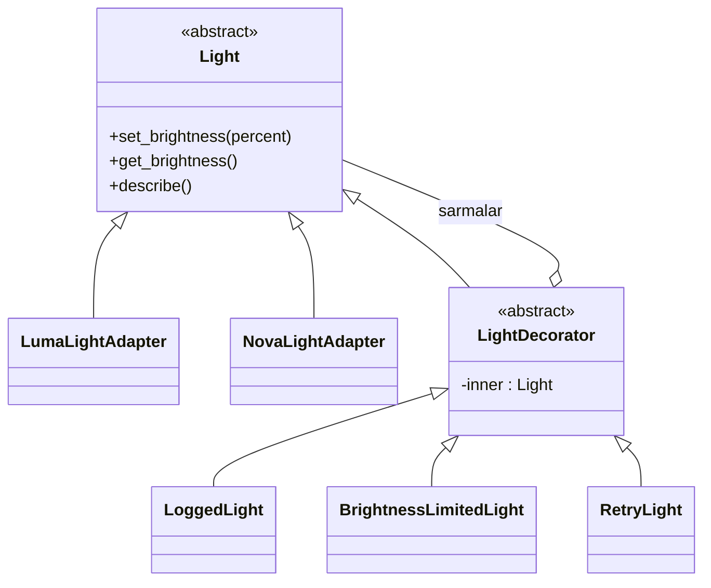
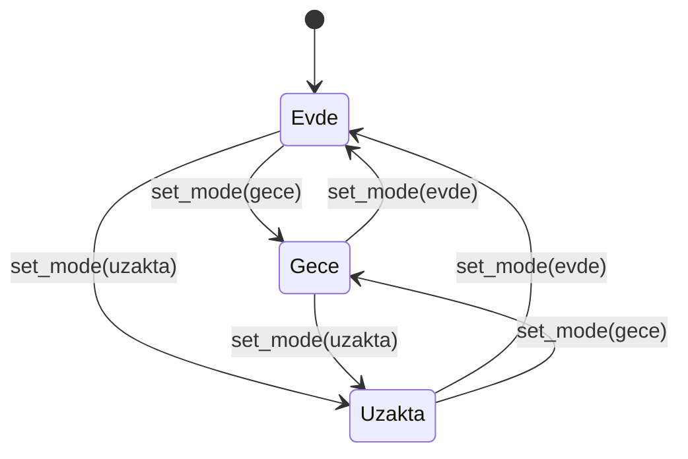

# Tasarım Kalıpları ve Rol Eşlemesi

Tüm arayüzler `abc.ABC` ile açıkça tanımlanmıştır. Dile gömülü karşılıklar (lambda, desen eşleme) veya çerçevenin hazır kalıpları kullanılmamıştır; kalıplar bu projede yazılmıştır.

| # | Kalıp | Grup | Dosya |
|---|---|---|---|
| 1 | Adapter | Yapısal | `akilli_ev/adapters.py` |
| 2 | Decorator | Yapısal | `akilli_ev/decorators.py` |
| 3 | Facade | Yapısal | `akilli_ev/facade.py` |
| 4 | Abstract Factory | Yaratımsal | `akilli_ev/factories.py` |
| 5 | Command | Davranışsal | `akilli_ev/commands.py` |
| 6 | Mediator | Davranışsal | `akilli_ev/mediator.py` |
| 7 | State | Davranışsal | `akilli_ev/modes.py` |

## 1. Adapter

**Problem:** `LumaBridge` (sözlük yükü, 0-254 parlaklık, Fahrenheit) ve `NovaCloud` (0-10 seviye, onda bir derece) değiştirilemeyen, birbirinden farklı SDK'lardır.
**Çözüm:** Adapter sınıfları bunları sistemin kendi arayüzlerine uyarlar; dönüşümler yalnızca adaptörlerdedir.
**Kaldırılırsa:** Üretici ayrıntıları hub, komutlar ve istemci koduna sızar.

| Rol | Sınıf |
|---|---|
| Target | `Light`, `Thermostat` (`devices.py`) |
| Adaptee | `LumaBridge`, `NovaCloud` |
| Adapter | `LumaLightAdapter`, `LumaThermostatAdapter`, `NovaLightAdapter`, `NovaThermostatAdapter` |

Test: `tests/test_adapters.py`

## 2. Decorator

**Problem:** Günlükleme, parlaklık sınırı ve yeniden deneme bağımsız davranışlardır ve birlikte, istenen sırayla kullanılır. Her kombinasyon için alt sınıf yazmak 2 üretici × 2³ = 16 sınıf, bir davranış daha eklenince 32 sınıf demektir. Üst sınıfta bayraklar tutmak ise her yeni davranışta üst sınıfı değiştirir ve anlamsız birleşimlere (termostata parlaklık sınırı) izin verir. İkisi de `examples/` altında çalışan kötü tasarım örnekleriyle gösterilmiştir.
**Çözüm:** Davranışlar `Light` arayüzünü sarmalayan dekoratörlerdir; çalışma anında `wrap_light` ile iç içe eklenir.
**Bedeli:** Sarmalama sırası sonucu değiştirir; dekoratörlü nesne somut tipinin örneği olmaz; zincirin ortasından eleman çıkarmak zordur.

| Rol | Sınıf |
|---|---|
| Component | `Light` |
| ConcreteComponent | `LumaLightAdapter`, `NovaLightAdapter` |
| Decorator | `LightDecorator` |
| ConcreteDecorator | `LoggedLight`, `BrightnessLimitedLight`, `RetryLight` |

Test: `tests/test_decorators.py`. Ayrıntılı sorular: [DECORATOR_SORULARI.md](DECORATOR_SORULARI.md)

## 3. Facade

**Problem:** İstemci fabrikaları, hub'ı, komut yöneticisini ve sahneleri bilmek zorunda kalırdı.
**Çözüm:** `SmartHomeFacade` bunları gizler: `add_light`, `set_thermostat`, `wrap_light`, `run_scene`, `set_mode`, `undo`, `motion`, `temperature`.

| Rol | Sınıf |
|---|---|
| Facade | `SmartHomeFacade` |
| Alt sistem | `HomeHub`, `CommandInvoker`, `DeviceFactory`, sensörler |

Test: `tests/test_facade.py`

## 4. Abstract Factory

**Problem:** Bir üreticinin cihazları tutarlı bir aile olarak üretilmeli ve aynı bağlantıyı paylaşmalıdır; istemci somut sınıfları bilmemelidir.
**Çözüm:** `DeviceFactory` ışık ve termostat üretir; her somut fabrika kendi üreticisinin ailesini ve tek bağlantısını yönetir.
**Sınır:** Yeni üretici yeni bir fabrikadır; yeni cihaz türü (ör. kilit) ise tüm fabrikaları değiştirir.

| Rol | Sınıf |
|---|---|
| AbstractFactory | `DeviceFactory` |
| ConcreteFactory | `LumaFactory`, `NovaFactory` |
| AbstractProduct | `Light`, `Thermostat` |
| ConcreteProduct | Adapter sınıfları |

Test: `tests/test_factories.py`

## 5. Command

**Problem:** Cihaz eylemleri geri alınabilmeli ve birden çok eylem "sahne" olarak birleştirilebilmelidir.
**Çözüm:** Eylemler `Command` nesnesidir; `MacroCommand` sahneyi oluşturur ve ters sırada geri alır; `CommandInvoker` geçmişi tutar.

| Rol | Sınıf |
|---|---|
| Command | `Command` |
| ConcreteCommand | `SetBrightnessCommand`, `SetTemperatureCommand`, `MacroCommand` |
| Receiver | `Light`, `Thermostat` |
| Invoker | `CommandInvoker` |
| Client | `SmartHomeFacade`, `HomeHub` (komutları oluşturur) |

Test: `tests/test_commands.py`

## 6. Mediator

**Problem:** Sensörler cihazları doğrudan çağırsaydı her sensör her cihaza bağımlı olurdu.
**Çözüm:** Sensörler yalnızca `Mediator` arayüzüne olay bildirir; `HomeHub` olayı ilgili davranışa yönlendirir.

| Rol | Sınıf |
|---|---|
| Mediator | `Mediator` |
| ConcreteMediator | `HomeHub` |
| Colleague | `Sensor` |
| ConcreteColleague | `MotionSensor`, `TemperatureSensor` |

Test: `tests/test_mediator_and_modes.py`

## 7. State

**Problem:** Aynı olay evin moduna göre farklı tepki gerektirir (evdeyken ışık, geceleyin loş ışık, uzaktayken alarm). Bu `if mode == ...` zincirlerine dönerdi.
**Çözüm:** Her mod ayrı bir durum sınıfıdır; moda giriş davranışı (`on_enter`) da burada toplanır.

| Rol | Sınıf |
|---|---|
| State | `ModeState` |
| ConcreteState | `AtHomeMode`, `NightMode`, `AwayMode` |
| Context | `ModeManager` |

Test: `tests/test_mediator_and_modes.py`

## Bilinen sınırlar (dürüst notlar)

- `ModeManager` içindeki mod sözlüğü ve `SmartHomeFacade` içindeki sahne sözlüğü, yeni mod/sahne eklendiğinde bir satır güncellemesi ister; bu iki yerde Açık-Kapalı Prensibi tam sağlanmaz.
- Adapter'lar cihazın son bilinen durumunu kendi içinde tutar; cihaz dışarıdan değiştirilirse bu değer eskiyebilir.
- Dekoratörlü nesne somut adaptör tipinin örneği değildir; tipe bakan kod bozulur.
